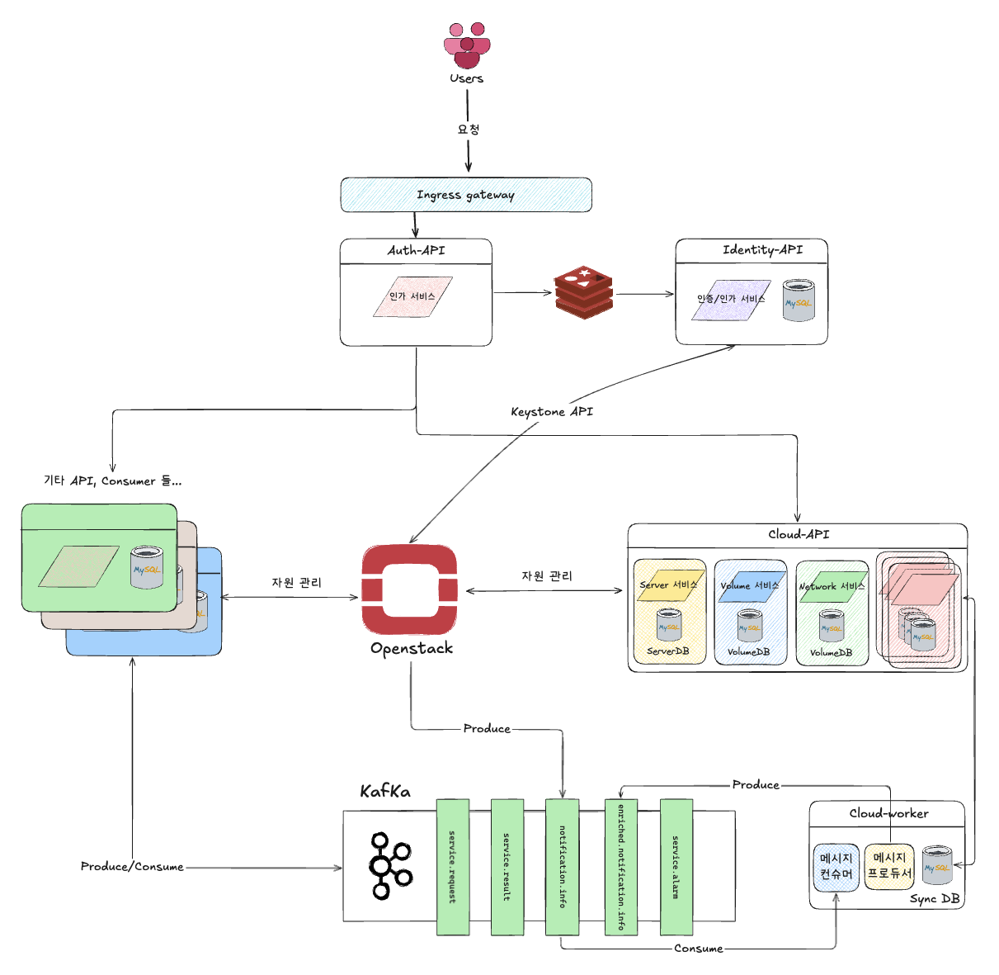

Openstack 기반 클라우드 플랫폼 개발
===================================

**수행 기간 : 2023.06 ~ 현재**

프로젝트 개요
-------------

역할 및 기여
------------

- Kafka 메시지 컨슈머 개발

개발 환경
---------

- Python 3.11
- FastAPI, Sqlalchemy, alembic
- MySql, Redis, Kafka
- Gitlab CI/CD

아키텍처
--------

