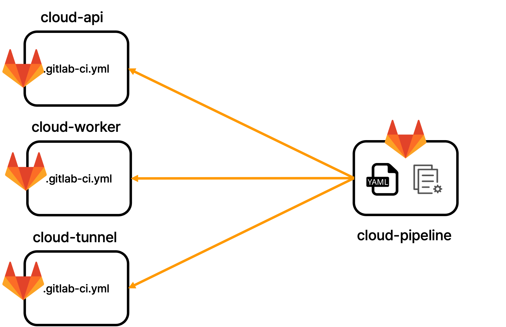

공통 CI/CD 파이프라인
=====================

프로젝트 개요
-------------

팀에서 사용하는 CI 관련 스크립트를 표준화 하고 모든 프로젝트에서 참조할 수 있게 하는 공통 파이프라인 스크립트를 만드는 프로젝트

핵심 기능
---------

- 표준화 된 CI/CD 스크립트
- CI/CD 단계에서 스크립트를 하나의 레포지토리에서 관리할 수 있는 형태로 구현
- 재사용 가능한 CI JOB을 제공

개발 환경
---------

- Gitlab CI/CD
- yaml

성과
----

Before
======

After
=====

- 모든 프로젝트가 동일한 파이프라인을 가질 수 있게 변경
- CI/CD 관련 템플릿을 하나의 소스에서 관리할 수 있게 개선
- 새로운 프로젝트에 CI/CD 파이프라인을 적용하기 쉽게 개선
- 새로운 파이프라인 STEP/JOB을 추가하기 쉬운 형태로 변경
