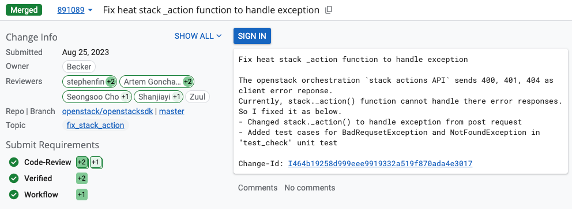
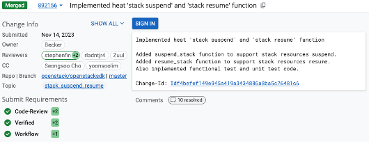
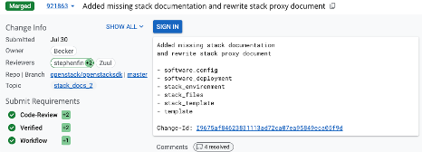

Openstack 기여
==============

Openstack SDK 기여 내역
-----------------------

1. stack._action() 예외처리 로직 추가
^^^^^^^^^^^^^^^^^^^^^^^^^^^^^^^^^^^^^

- 기존 오픈스택 API를 활용하는 코드에서 처리되어야 하는 예외코드(400,401,404)에 대한 예외 처리 기능이 누락
- 예외처리 로직을 추가하고 테스트 코드를 작성해서 패치셋을 작성

- 리뷰 내역 : https://review.opendev.org/c/openstack/openstacksdk/+/891089

----

2. stack suspend, resume 기능 추가
^^^^^^^^^^^^^^^^^^^^^^^^^^^^^^^^^^

- Stack 자원에 대한 정지(suspend), 재시작(resume)을 사용할 수 있는 SDK 함수가 미구현
- suspend, resume 기능을 구현 후 기능/단위 테스트를 작성

- 리뷰 내역 https://review.opendev.org/c/openstack/openstacksdk/+/892156

----

3. 누락 문서 추가
^^^^^^^^^^^^^^^^^

- Openstack SDK에서 stack 기능을 설명하는 문서가 누락되어 해당 문서를 추가
- 추가 된 문서 링크 - `Orchestration API — openstacksdk 4.2.1.dev14 documentation <https://docs.openstack.org/openstacksdk/latest/user/proxies/orchestration.html#stack-operations%20%20Copy>`_

- 리뷰 내역 https://review.opendev.org/c/openstack/openstacksdk/+/921863
